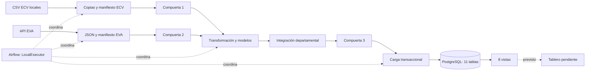
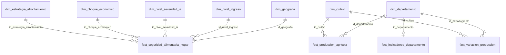
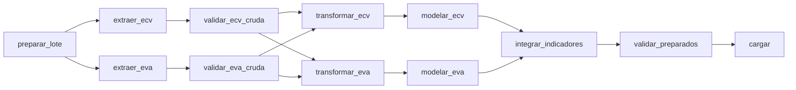
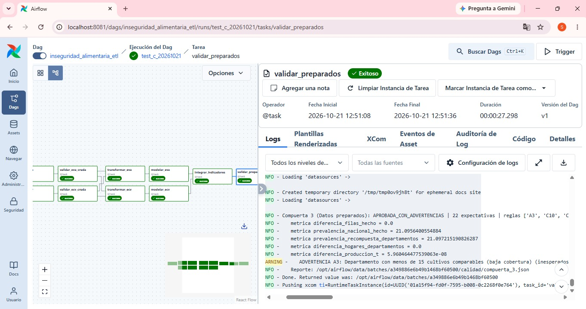
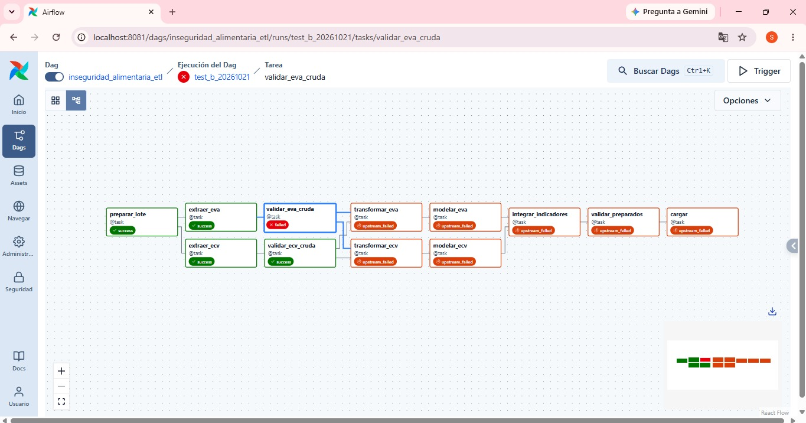
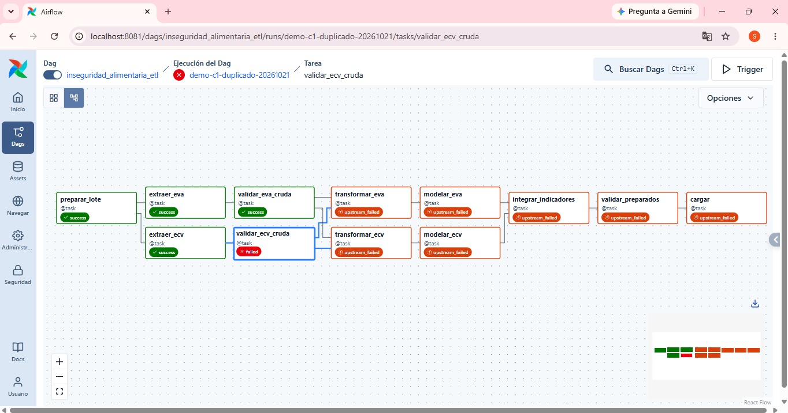

# Factores socioeconómicos asociados a la inseguridad alimentaria en los hogares colombianos

Proyecto académico de integración de la ECV 2025 del DANE y las Evaluaciones Agropecuarias Municipales (EVA) de la UPRA.

## 1. Problema y objetivo analítico

| Elemento | Descripción |
|---|---|
| Problema | Diferencias territoriales y socioeconómicas en la inseguridad alimentaria de los hogares colombianos. |
| Pregunta | ¿Qué factores socioeconómicos, territoriales y de condiciones de vida están asociados con una mayor prevalencia de inseguridad alimentaria? |
| Objetivo general | Integrar y preparar información de hogares y producción agrícola para estudiar esas asociaciones. |
| Objetivos específicos | Caracterizar territorio, servicios, choques, afrontamiento e ingreso (R1–R5); relacionar diversidad y variación agrícola con la prevalencia departamental (R6–R7). |
| Unidad de análisis | Hogar para R1–R5; departamento para la integración R6–R7. |
## 2. Línea base de la primera entrega y repositorio

**Repositorio:** [Primera entrega, rama `dev`](https://github.com/Sxg0673/etl-inseguridad-alimentaria-colombia/tree/dev).

| Aspecto | Línea base documentada | Evolución comprobable |
|---|---|---|
| Alcance | R1–R5 sobre ECV 2025. | R6–R7 y extracción agrícola. |
| Preparación | Limpieza, transformación y modelo de hogares descritos en la documentación previa. | [Módulos ECV](src/ecv) integrados al DAG. |
| Modelo | Cinco dimensiones y un hecho por hogar. | Dos dimensiones agrícolas y tres hechos adicionales; 11 tablas. |
| Ejecución y calidad | Referencia metodológica previa. | Lotes verificables, tres compuertas GX y carga transaccional. |

La rama `dev` es mutable; la referencia queda fijada en el commit `e5ff76d` (estado de `dev` al 21 de octubre de 2026). La evolución local se observa en `57434a6` (DAG), `10cd0c6` (vistas) y `7688577` (pruebas y guías).

## 3. Estado y cambios de R1–R5

| Requisito | Descripción | Implementación | Archivos relacionados | Evidencia |
|---|---|---|---|---|
| R1 | Distribución territorial de la inseguridad alimentaria. | Geografía y prevalencias ponderadas. | [Transformación](src/ecv/transform.py), [vistas](sql/vistas_analiticas.sql). | `vw_r1_distribucion_territorial`; perfil ECV. |
| R2 | Asociación entre servicios públicos y vulnerabilidad alimentaria. | Acueducto y alcantarillado en el hecho. | [Modelo ECV](src/ecv/dimensional_model.py), [vistas](sql/vistas_analiticas.sql). | `vw_r2_servicios_publicos`. |
| R3 | Relación entre choques económicos e inseguridad alimentaria. | Once banderas y conteo. | [Transformación](src/ecv/transform.py), [modelo](src/ecv/dimensional_model.py). | `vw_r3_choques_economicos`; C13. |
| R4 | Afrontamiento según severidad alimentaria. | Catorce banderas, conteo y severidad. | [Transformación](src/ecv/transform.py), [vistas](sql/vistas_analiticas.sql). | `vw_r4_estrategias_severidad`; C12–C13. |
| R5 | Vulnerabilidad según ingreso del hogar. | Quintiles ponderados y categoría inconsistente. | [Limpieza](src/ecv/clean.py), [transformación](src/ecv/transform.py). | `vw_r5_quintiles_ingreso`. |


## 4. Nuevos requerimientos integrados R6 y R7

| Requisito | Pregunta y propósito |
|---|---|
| R6 | ¿Cómo se relaciona la diversidad alimentaria agrícola de 2025 con la prevalencia FIES departamental? |
| R7 | ¿Los departamentos con caídas productivas entre 2024 y 2025 presentan mayor prevalencia FIES? |

Evidencia: [modelo agrícola](src/eva/dimensional_model.py), [pruebas sintéticas](tests/test_eva_modelo.py) y C14–C16. La integración agrega antes del cruce y no atribuye producción a hogares individuales.

## 5. Fuente primaria y fuente mediante API

| Característica | ECV 2025 | EVA 2024–2025 |
|---|---|---|
| Responsable | DANE, DIMPE. | UPRA; publicación en Datos Abiertos Colombia. |
| Fuente oficial | [Catálogo DANE 905](https://microdatos.dane.gov.co/index.php/catalog/905/get-microdata). | [Conjunto de datos EVA](https://www.datos.gov.co/Agricultura-y-Desarrollo-Rural/Evaluaciones-Agropecuarias-Municipales-EVA-2019-20/uejq-wxrr/about_data). |
| Acceso técnico | Descarga manual de tres CSV y copia local por corrida. | HTTP GET a [API Socrata](https://www.datos.gov.co/resource/uejq-wxrr.json). |
| Formato | `;`, `utf-8-sig`, lectura como texto. | JSON; el perfil recibe los valores como texto. |
| Granularidad | Vivienda y hogar. | Municipio × código de cultivo × período. |
| Claves | `DIRECTORIO`, `ORDEN`; departamento `P1_DEPARTAMENTO`. | `c_digo_dane_departamento`, `c_digo_dane_municipio`, `c_digo_del_cultivo`, `periodo`. |
| Variables | `FEX_C`, `PROB_IAMG`, `PROB_IAG`, ingreso, servicios, choques y estrategias. | `cultivo`, `a_o`, `periodo`, `producci_n`, áreas, rendimiento y atributos del cultivo. |
| Consulta | [Archivos y descarga](data/raw/README.md). | `$where=a_o=2024` o `2025`; `$select=count(*)`; páginas de 5.000 con `$order=:id`, `$limit`, `$offset`. |
| Limitación | CSV reales no distribuidos en Git. | Datos revisables; conservar fecha y respuesta. |

Implementación: [extractor ECV](src/ecv/extract.py) y [extractor EVA](src/eva/extract.py). DANE/UPRA son los orígenes institucionales; CSV y API son los mecanismos de acceso.

## 6. Valor analítico aportado por la API

| Aporte EVA | Complemento ECV | Análisis habilitado |
|---|---|---|
| Cultivos con producción positiva en 2025. | Prevalencia FIES departamental. | Diversidad agrícola frente a inseguridad alimentaria (R6). |
| Producción por cultivo en 2024 y 2025. | Condición alimentaria de 2025. | Porcentaje de cultivos en descenso frente a prevalencia (R7). |
| Código y cobertura territorial. | Departamento del hogar. | Comparación territorial con faltantes y baja cobertura explícitos. |

La ECV sola no incorpora esos indicadores agrícolas. El cruce departamental no identifica qué produce o consume cada hogar; toneladas no equivalen a calorías.

## 7. Arquitectura del sistema



| Componente | Función y decisión |
|---|---|
| [Lotes](src/comun/lotes.py) | Aislar corridas y verificar integridad con SHA-256. |
| [Artefactos](src/comun/artefactos.py) | Parquet conserva tipos/nulos; lectura verificada contra manifiesto. |
| [Compuertas](src/calidad/compuertas.py) | Bloquear transformación/carga ante reglas críticas. |
| [Compose](docker-compose.yaml) | Airflow 3.1.8 con LocalExecutor, PostgreSQL 16 y bases separadas para metadatos/analítica. La configuración actual no usa Celery ni Redis. |

## 8. Hallazgos del perfilamiento

Cifras de la extracción documentada el 20 de octubre de 2026, 23:37 UTC; no son una consulta actual. [Hallazgos completos](notebooks/hallazgos_perfilamiento.md), [notebook EVA](notebooks/01_profiling_eva.ipynb) y [notebook ECV](notebooks/02_profiling_ecv_departamental.ipynb): conservan salidas en 33 y 11 celdas de código.

| Tema | Hallazgo documentado | Implicación |
|---|---|---|
| Volumen EVA | 25.553 registros de 2024 y 25.617 de 2025; total 51.170; diferencia con conteo API: cero. | Paginar y conciliar. |
| Esquema EVA | 18 campos; texto; sin negativos ni formatos inválidos en las cuatro medidas. | Convertir explícitamente con punto decimal. |
| Unicidad EVA | Sin duplicados exactos ni de municipio–código–período. | C7 evita doble suma. |
| Identificadores | 1.102 códigos municipales y 1.020 nombres; 160 cultivos y 187 desagregaciones. | Integrar por código; contar cultivos, no desagregaciones. |
| Dominios | 8 grupos, 2 ciclos, 10 estados físicos y 6 períodos. | Conservar atributos y revisar período/año. |
| Marcadores | «No aplica» en nombre científico: 815 registros. | Campo ajeno a R6–R7. |
| Coherencia agrícola | 6.950 casos de cosechada > sembrada; 1.412 de siembra cero con cosecha positiva. | No rechazar automáticamente: fuente admite cosechas de siembras previas. |
| Atípicos | 2 rendimientos >10 veces la mediana; ninguno >20 veces. | Advertencia A2 con umbral 20. |
| Cobertura | 32 departamentos EVA, sin Bogotá. | Conservar faltantes agrícolas. |
| Períodos | 8 casos de «Plantas aromáticas» combinan anual y semestral. | Riesgo de doble suma; fuera de canasta. |
| Repetición temporal | Producción idéntica: 5.923 de 23.071 pares (25,7 %); tres medidas idénticas: 19,0 %. | Variación cero no prueba estabilidad. |
| Comparabilidad preliminar | 43 bases cero, 34 solo 2024 y 24 solo 2025, antes del filtro final de canasta. | Marcar casos no comparables. |
| ECV | 87.060 hogares, 33 códigos departamentales; 6.365 códigos de un dígito. | Normalizar sin alterar grano. |
| FIES | 718 hogares sin probabilidad válida; prevalencia documentada 21,10 % moderada o grave. | Excluir nulos del denominador. |
| Ingreso | La limpieza documenta 3 inconsistencias de ingreso per cápita. | Categoría separada, sin borrar hogares. |

Las 3.876 filas del perfil preliminar por **código** no corresponden al conteo definitivo por **cultivo**. Una corrida nueva debe volver a validar las fuentes.

## 9. Riesgos y reglas de calidad

[Catálogo y justificación](docs/reglas_calidad.md). Son 19 identificadores de regla: 16 críticos y 3 advertencias; cada uno puede agrupar varias expectativas.

| ID | Riesgo y entidad | Regla de calidad | Severidad | Consecuencia |
|---|---|---|---|---|
| C1 | Hogares duplicados/no identificados. | `DIRECTORIO`, `ORDEN` únicos y no nulos. | Crítica | Detener. |
| C2 | Departamento ECV sin correspondencia. | Código normalizado válido y no nulo. | Crítica | Detener. |
| C3 | EVA incompleta. | Extraídos menos conteo API = 0 y disponible por año. | Crítica | Detener. |
| C4 | Cambio de esquema EVA. | Presencia de 18 campos; admite adicionales. | Crítica | Detener. |
| C5 | Año/período incorrecto. | Ambos años y períodos coherentes. | Crítica | Detener. |
| C6 | Medidas EVA inválidas. | Cuatro medidas no nulas y numéricas no negativas. | Crítica | Detener. |
| C7 | Doble suma EVA. | Municipio–código–período único. | Crítica | Detener. |
| C8 | Territorio EVA inválido. | DIVIPOLA, municipio de cinco dígitos y prefijo coherente. | Crítica | Detener. |
| C9 | Canasta alterada. | Cultivo clasificado como incluido o excluido. | Crítica | Detener. |
| C10 | Pérdida/multiplicación de hogares. | Llaves únicas; filas del hecho = transformados. | Crítica | Detener. |
| C11 | Prevalencia/integración errónea. | Nacional y recompuesta: 21,1 % ±0,1 puntos; suma de hogares conciliada. | Crítica | Detener. |
| C12 | FIES faltante tratada como válida. | «Sin dato» equivale a probabilidad nula. | Crítica | Detener. |
| C13 | Conteos incoherentes. | Suma de banderas; sin choque equivale a sin estrategia. | Crítica | Detener. |
| C14 | Producción alterada. | Llave del agregado única; diferencia total <1 tonelada. | Crítica | Detener. |
| C15 | Departamentos duplicados o imputados. | 33 filas únicas; faltantes agrícolas preservados. | Crítica | Detener. |
| C16 | Falsa caída/división inválida. | Estados explícitos, nulos coherentes, variación finita ≥−100 %, descenso entre 0 y 100 %. | Crítica | Detener. |
| A1 | Cobertura insuficiente. | Al menos 32 departamentos por año. | Advertencia | Continuar y registrar. |
| A2 | Rendimiento extremo. | ≤20 veces la mediana del código. | Advertencia | Continuar y registrar. |
| A3 | Pocos cultivos comparables. | Advertir si hay menos de 15. | Advertencia | Continuar y registrar. |

A1 se describía como igualdad a 32, pero el código exige un **mínimo** de 32. C10 contrasta con transformados, no directamente con la fuente cruda.

## 10. Diseño de Great Expectations y trazabilidad de reglas

[GX común](src/calidad/gx_comun.py): versión **1.23.1**, contexto efímero, fuente pandas, activo de DataFrame completo, suite, definición de validación y punto de control con salida `SUMMARY`. No requiere suites persistentes en `gx/`.

| Reglas | Expectativas implementadas | Datos/etapa | Requisitos | Evidencia |
|---|---|---|---|---|
| C1, C7 | `ExpectCompoundColumnsToBeUnique`; C1 añade `ExpectColumnValuesToNotBeNull`. | ECV y EVA crudas, compuertas 1–2. | R1–R7 | [Compuertas](src/calidad/compuertas.py). |
| C2, C5, C8, C9 | `ExpectColumnValuesToBeInSet`, `ExpectColumnDistinctValuesToEqualSet`, `ExpectColumnValuesToMatchRegex`; no nulo en C2. | ECV/EVA crudas. | R1, R6–R7 | [Compuertas](src/calidad/compuertas.py). |
| C3, C4, C6, A1–A2 | `ExpectColumnValuesToBeBetween`, `ExpectTableColumnsToMatchSet`, no nulos y expresión regular. | EVA cruda, compuerta 2. | R6–R7 | [Compuertas](src/calidad/compuertas.py). |
| C10, C14, C15 | Unicidad, `ExpectTableRowCountToEqual`, intervalos. | Preparados, compuerta 3. | R1–R7 | [Compuertas](src/calidad/compuertas.py). |
| C11–C13, C16, A3 | Intervalos y conjuntos sobre métricas/columnas derivadas. | Preparados, compuerta 3. | Según sección 9. | [Compuertas](src/calidad/compuertas.py). |

Cada resultado registra regla, severidad, tabla, expectativa, éxito, métricas y ejemplos en `calidad/compuerta_N.json`. Estados: `aprobada`, `aprobada_con_advertencias` o `rechazada`. Una crítica lanza `ErrorCalidadCritica`; una advertencia no bloquea. Las tres compuertas se ejecutaron en las corridas de la sección 18 (capturas); los JSON de cada lote no se conservan en el repositorio.

## 11. Validación cruda de ambas fuentes

| Control | ECV: compuerta 1 | EVA: compuerta 2 |
|---|---|---|
| Estructura/tipos | Lectura textual de columnas necesarias; faltantes provocan error. No hay suite de esquema completo. | Exige 18 campos y formato de cuatro medidas numéricas. |
| Identificadores | Hogar no nulo y único; departamento válido tras `zfill(2)`. | Llave natural única; departamento/municipio y prefijo válidos. |
| Completitud | Claves del hogar y departamento; no todas las variables analíticas crudas. | Medidas sin nulos, ambos años y conciliación API. |
| Dominios | DIVIPOLA departamental. | Años, períodos, códigos y catálogo de cultivos. |
| Inválidos | Sin cuarentena ni descarte automático. | A1/A2 registran advertencias; sin cuarentena. |
| Falla crítica | Bloquea las dos transformaciones. | Bloquea las dos transformaciones. |

Separar las compuertas permite identificar la fuente del incumplimiento antes de integrar. Código: [compuertas](src/calidad/compuertas.py), [lectura ECV](src/ecv/extract.py) y [lectura EVA](src/eva/extract.py).

## 12. Transformación y contrato de integración

| Decisión | Implementación | Justificación |
|---|---|---|
| [Limpieza ECV](src/ecv/clean.py) | Retira 21 contenedoras, normaliza departamento y marca ingreso inconsistente. | Conservar variables útiles y hogares. |
| [Integración ECV](src/ecv/transform.py) | Uniones izquierdas por hogar y luego vivienda. | Mantener grano hogar. |
| Categorías | Servicios 1/2 a booleano; choques/estrategias marcado/no marcado. | No confundir vacío de selección múltiple con nulo analítico. |
| Severidad/ingreso | Puntajes 0, 1–3, 4–6 y 7–8; código 3 FIES implica «Sin dato»; quintiles por factor acumulado. | Segmentación R4–R5; cortes de severidad requieren respaldo metodológico. |
| Medidas ECV | Coma a punto; `to_numeric(errors='coerce')`. | Conversiones inválidas pasan a nulo: requieren seguimiento. |
| [Transformación EVA](src/eva/transform.py) | Punto decimal, año entero y sumas a departamento–cultivo–año; dos decimales. | Comparar cultivos y conservar producción; no sumar rendimientos. |
| [Canasta](config/canasta_cultivos.csv) | 160 cultivos clasificados, 139 incluidos; referencia metodológica P3204. | Selección explícita compartida por R6–R7; excepciones en [reglas](docs/reglas_calidad.md). |
| [Variación](src/eva/dimensional_model.py) | Estados `comparable`, `base_cero`, `solo_2024`, `solo_2025`. | Evitar divisiones por cero y falsas caídas. |
| Faltantes/duplicados | Bogotá con nulos agrícolas; no se deduplican silenciosamente registros crudos. | Distinguir ausencia de información de producción cero. |

| Contrato | Definición real |
|---|---|
| Claves | ECV interna: `DIRECTORIO`, `ORDEN`; vivienda por `DIRECTORIO`. Entre fuentes: código departamental. |
| Entrada | Hogar ECV; municipio–código–período EVA. |
| Salida | Hogares intactos y una tabla departamental de indicadores para ECV 2025. |
| Año | Filtros 2024/2025 y diversidad 2025; **no** es columna de unión del cruce final. |
| Unión | Dimensión departamental como base; uniones izquierdas de agregados; ECV validada `one_to_one`. |
| No coincidentes | Código ECV sin dimensión detiene; ausencia agrícola conserva nulos. |
| Columnas finales | Campos de `fact_indicadores_departamento` descritos en sección 13. |
| Calidad | C10–C16; agregar antes de cruzar evita multiplicar hogares. |

**Fórmulas implementadas:** las probabilidades FIES ya están en escala 0–100: `prevalencia = Σ(factor × probabilidad) / Σ(factor)` sobre hogares con FIES válida, sin otro factor 100. Esto sustituye la formulación binaria preliminar. R7: `variacion_pct = 100 × (P2025/P2024 − 1)` y `pct_cultivos_en_descenso = 100 × descensos/comparables`.

## 13. Modelo dimensional refinado y justificación

Especificaciones: [DDL](sql/create_tables.sql), [modelo editable](docs/modelo_dimensional.dbml), [modelo ECV](src/ecv/dimensional_model.py) y [modelo EVA](src/eva/dimensional_model.py).

| Dimensión | Campos principales | Pregunta/función |
|---|---|---|
| `dim_geografia` | `id_geografia`; códigos/nombres de departamento, región y clase. | R1; geografía del hogar. |
| `dim_nivel_ingreso` | `id_nivel_ingreso`, `codigo_quintil`, `nombre_quintil`. | R5; quintiles y categoría inconsistente. |
| `dim_nivel_severidad_ia` | `id_nivel_severidad_ia`, `nombre_severidad`, límites de puntaje. | R4; severidad. |
| `dim_choque_economico` | `id_choque_economico`, 11 banderas `choque_*`, `numero_choques`. | R3; combinaciones observadas. |
| `dim_estrategia_afrontamiento` | `id_estrategia_afrontamiento`, 14 banderas `estrategia_*`, `numero_estrategias`. | R4; combinaciones observadas. |
| `dim_departamento` | `id_departamento`, `codigo_departamento`, `nombre_departamento`. | R6–R7; código geográfico compartido. |
| `dim_cultivo` | `id_cultivo`, nombre, grupo, subgrupo, ciclo, estado físico, `en_canasta`, `motivo_canasta`. | R6–R7; cultivo y canasta. |

| Hecho | Grano y claves | Medidas/indicadores |
|---|---|---|
| `fact_seguridad_alimentaria_hogar` | Hogar; PK `id_hogar`; natural única `directorio`, `orden`; cinco FK ECV. | Servicios booleanos, `factor_expansion`, `prob_ia_moderada_grave`, `prob_ia_grave`; prevalencias R1–R5. |
| `fact_produccion_agricola` | Departamento–cultivo–año; PK `id_produccion`; combinación única y dos FK. | `area_sembrada_ha`, `area_cosechada_ha`, `produccion_t`, `numero_municipios`, `fecha_extraccion`. |
| `fact_variacion_produccion` | Departamento–cultivo, 2024→2025; PK compuesta y dos FK. | `produccion_2024_t`, `produccion_2025_t`, `variacion_pct`, `estado_comparabilidad`, `en_descenso`. |
| `fact_indicadores_departamento` | Departamento para 2025; PK/FK `id_departamento`. | `hogares_muestra`, `hogares_con_fies`, `hogares_expandidos`, `prevalencia_ia_moderada_grave`, `prevalencia_ia_grave`, `diversidad_cultivos_2025`, `cultivos_comparables`, `cultivos_en_descenso`, `pct_cultivos_en_descenso`, `baja_cobertura`. |



Se preserva el grano hogar y se añaden hechos con granos agrícolas distintos. `dim_departamento` y `dim_geografia` comparten código, sin FK física entre ambas. Las claves sustitutas son enteros reconstruidos en cada carga; no hay historización de dimensiones. El año es atributo del hecho agrícola; los consolidados fijan sus períodos en el código.

## 14. Validación de datos preparados

| Grupo | Comprobación | Límite actual |
|---|---|---|
| Hogares | C10 identidad/conteos; C12 FIES/severidad; C13 banderas/conteos. | Conteo confrontado con transformados, no fuente cruda. |
| Integración | C11 prevalencia recompuesta y hogares; C15 departamentos únicos y faltantes. | Referencia 21,1 % fijada a esta edición ECV. |
| Agricultura | C14 producción/llave; C16 comparabilidad/nulos/rangos; A3 cobertura. | No sustituye todas las restricciones SQL. |
| Autorización | Compuerta 3 aprobada, incluso con advertencias; reporte y Parquet íntegros. | Integridad referencial completa se exige al insertar en PostgreSQL. |

[Implementación](src/calidad/compuertas.py): las compuertas 1–2 preceden la transformación; la 3 sucede al modelado/integración. No existe validación GX exhaustiva de todos los tipos o FK antes de cargar.

## 15. Implementación y carga del almacén de datos

| Aspecto | Implementación |
|---|---|
| Motor/esquema | PostgreSQL 16, base `warehouse`, esquema `public`. |
| Estructura | 11 tablas del [DDL](sql/create_tables.sql) y 8 [vistas](sql/vistas_analiticas.sql). |
| Estrategia | [Carga completa](src/carga.py): crear si no existe, `TRUNCATE` conjunto, inserciones de 5.000, conteos y recreación de vistas. |
| Orden | Siete dimensiones antes de cuatro hechos. |
| Transacción | Un bloque de conexión; un error revierte el reemplazo completo. |
| Restricciones | PK, `UNIQUE`, `NOT NULL`, FK y comprobaciones del DDL; no hay actualización incremental. |
| Conciliación | Conteos SQL iguales a cada Parquet; no compara contenido fila a fila durante la carga. |
| Informe | `carga/carga.json`, escrito después del commit: fecha, estado de compuerta y filas por tabla. |


## 16. Diseño del DAG e interfaces de tareas

[DAG](dags/etl_dag.py): `inseguridad_alimentaria_etl`; manual (`schedule=None`), `catchup=False`, una corrida activa y 30 minutos por tarea. Parámetro booleano `falla_controlada=False`.



| Tarea | Responsabilidad/entrada | Salida en el lote | Éxito |
|---|---|---|---|
| `preparar_lote` | Carpeta desde `run_id`. | `lote.json` y ruta. | Creada/reutilizada. |
| `extraer_ecv` | Congelar tres CSV locales. | `ecv/raw/` y manifiesto. | Archivos registrados. |
| `validar_ecv_cruda` | C1–C2 sobre copias íntegras. | `calidad/compuerta_1.json`. | Sin críticas fallidas. |
| `extraer_eva` | Conteos/páginas o copia previa; parámetro de prueba. | `eva/raw/eva_2024_2025.json`. | Extracción guardada. |
| `validar_eva_cruda` | C3–C9, A1–A2. | `calidad/compuerta_2.json`. | Sin críticas fallidas. |
| `transformar_ecv` | Limpiar/integrar ECV. | `ecv/procesado/hogares_transformados.parquet`. | Transformación terminada. |
| `modelar_ecv` | Tabla transformada a modelo. | Seis tablas Parquet. | Modelo construido. |
| `transformar_eva` | Convertir, agregar, clasificar canasta. | `eva/procesado/produccion_agregada.parquet`. | Cultivos clasificados. |
| `modelar_eva` | Agregado y DIVIPOLA a modelo. | Cuatro tablas Parquet. | Referencias coherentes. |
| `integrar_indicadores` | Ambos modelos agregados. | `integrado/procesado/fact_indicadores_departamento.parquet`. | Sin código ECV huérfano. |
| `validar_preparados` | C10–C16, A3. | `calidad/compuerta_3.json`. | Sin críticas fallidas. |
| `cargar` | Tablas aprobadas y URL del almacén. | Tablas, vistas, `carga/carga.json`. | Commit y conteos conciliados. |

Las tareas reciben y devuelven la ruta del lote por XCom; los datos están en disco, no en memoria compartida. [Configuración](src/comun/config.py): rutas por entorno y conexión `ETL_DATABASE_URL`, sin Airflow Connections. La [captura del grafo](docs/inseguridad_alimentaria_etl-graph.png) acredita el diseño visible, no una corrida exitosa.

## 17. Políticas de fallos y reintentos

El proceso diferencia fallos transitorios, errores deterministas y advertencias. Solo los fallos transitorios de extracción EVA o conexión al almacén tienen reintentos configurados.

| Situación | Tratamiento | Reintentos | Efecto en el proceso |
|---|---|---|---|
| Red, tiempo de espera o HTTP 429/500/502/503/504 en EVA. | `ErrorTransitorio` si persiste. | Una petición inicial y hasta tres reintentos con esperas de 2, 4 y 8 segundos; `extraer_eva` tiene además dos reintentos cada cinco minutos. | La tarea puede recuperarse si la fuente vuelve a estar disponible. |
| JSON no válido. | Reintenta la petición; si persiste, `ErrorTransitorio`. | Misma política de extracción EVA. | Detiene la rama si se agotan los intentos. |
| Base de datos inaccesible. | `ErrorTransitorio` al conectar. | `cargar`: dos reintentos cada minuto. | No inicia la carga sin conexión. |
| Error crítico de calidad, como duplicados C1 o C7. | Error determinista convertido en `AirflowFailException`. | Sin reintentos. | Validación en `failed`; tareas dependientes en `upstream_failed`; no se ejecuta `cargar`. |
| Archivo alterado, respuesta HTTP no recuperable o estructura inesperada. | `ErrorDeterminista`. | Sin reintentos. | Se bloquean las etapas dependientes. |
| Error SQL durante la carga. | Error determinista y reversión de la transacción. | Sin reintentos. | Se conserva la carga anterior. |
| Advertencias A1–A3, incluida baja cobertura agrícola. | Registro en el informe de calidad y en los registros de ejecución. | No requieren reintento. | El proceso continúa; A3 sobre Guaviare no impidió la prueba 1. |
| Otras tareas. | Propagan el error. | Cero reintentos por defecto. | Las dependientes quedan bloqueadas. |

Implementación: [DAG](dags/etl_dag.py), [errores](src/comun/errores.py), [extractor EVA](src/eva/extract.py) y [carga](src/carga.py). Las pruebas 2 y 3 comprobaron el bloqueo por errores críticos; no constituyen pruebas de recuperación ante fallos de red o de base de datos.

## 18. Evidencia de ejecución exitosa y fallos controlados

Se realizaron tres pruebas del DAG `inseguridad_alimentaria_etl`: una ejecución normal y dos fallos inducidos. Las capturas conservadas respaldan los estados observados; las condiciones y resultados se documentan con la descripción de las pruebas realizada por el equipo.

| Prueba | Condición | Resultado observado | Evidencia |
|---|---|---|---|
| 1. Ejecución normal. | `falla_controlada=false`. | Flujo completo; preparados aprobados con advertencia A3 sobre Guaviare; carga ejecutada. | [Captura 1](docs/prueba1.jpeg). |
| 2. Duplicado EVA, C7. | `falla_controlada=true`. | `validar_eva_cruda` en `failed`, sin reintentos; dependientes en `upstream_failed`; sin carga. | [Captura 2](docs/prueba2.jpeg). |
| 3. Duplicado de hogar ECV, C1. | Copia aislada de un CSV con una fila duplicada. | `validar_ecv_cruda` en `failed`; dependientes en `upstream_failed`; sin carga y origen sin cambios. | [Captura 3](docs/prueba3.jpeg). |

### Prueba 1. Ejecución normal

| Aspecto | Evidencia y resultado |
|---|---|
| Identificador visible | `test_c_20261021`. |
| Configuración | `falla_controlada=false`. |
| Recorrido | Extracción, validación cruda, transformación, modelado, integración, validación de preparados y carga completadas. |
| Compuerta de preparados | `APROBADA_CON_ADVERTENCIAS`; `validar_preparados` en `success`. |
| Advertencia | A3: baja cobertura de cultivos comparables en Guaviare. No es un error crítico y permitió continuar. |
| Conciliación visible | Diferencia de filas del hecho: 0; diferencia de hogares departamentales: 0; prevalencia nacional del hecho: aproximadamente 21,10 %. |
| Conclusión | Referencia del comportamiento normal: las advertencias se registran sin bloquear la carga. |



### Prueba 2. Error inducido C7 en EVA

| Aspecto | Evidencia y resultado |
|---|---|
| Identificador visible | `test_b_20261021`. |
| Configuración | `falla_controlada=true`. |
| Error inducido | La extracción EVA terminó correctamente e inyectó un registro duplicado. |
| Regla incumplida | C7: la llave municipio–**código de cultivo**–período debe ser única. |
| Detección | `validar_eva_cruda` detectó la llave repetida. El error determinista se convirtió en `AirflowFailException`. |
| Estado final | Validación en `failed`, sin reintentos; transformaciones, modelado, integración, validación de preparados y carga en `upstream_failed`. |
| Protección del almacén | `cargar` no se ejecutó: el error se detuvo antes de modificar el almacén. |
| Recuperación | Corregir la causa y crear una corrida nueva con `falla_controlada=false`; el lote anterior conserva el duplicado inducido. |



### Prueba 3. Error inducido C1 en ECV

| Aspecto | Evidencia y resultado |
|---|---|
| Identificador | `demo-c1-duplicado-20261021`. |
| Preparación | Copia aislada de un CSV ECV con una fila duplicada, utilizada únicamente para esta corrida. |
| Regla incumplida | C1: las llaves de hogar (`DIRECTORIO`, `ORDEN`) deben ser únicas y no nulas. La prueba evaluó el caso de duplicación. |
| Llave detectada | `DIRECTORIO=8369550`, `ORDEN=1`. |
| Detección | `validar_ecv_cruda` identificó el hogar repetido y quedó en `failed`. |
| Estado posterior | Transformaciones, modelado, integración, validación de preparados y carga quedaron en `upstream_failed`; `cargar` no se ejecutó. |
| Protección del origen | El CSV original permaneció sin cambios; la alteración se realizó sobre una copia. |
| Recuperación | Usar una entrada válida en una corrida nueva, manteniendo la copia de prueba separada del origen. |
| Conclusión | La validación de la fuente primaria también impide continuar cuando falla una regla crítica. |



## 19. Evidencia de fallo controlado

Los dos escenarios ejecutados se detallan en las pruebas 2 y 3 de la sección 18. Ambos muestran el patrón esperado: extracción completada, rechazo en la compuerta de la fuente alterada y tareas dependientes bloqueadas antes de la carga.

La prueba C7 se activa mediante el [extractor EVA](src/eva/extract.py); la prueba C1 utiliza una copia aislada de ECV. Las reglas están implementadas en [las compuertas de calidad](src/calidad/compuertas.py).

## 20. Repetibilidad y reejecución segura

| Propiedad | Mecanismo y alcance |
|---|---|
| Extracción repetible | Lote `sha256(run_id)[:24]`; misma corrida reutiliza copias sin consultar EVA otra vez. |
| Integridad | SHA-256, manifiestos y lecturas verificadas; temporales reemplazados al terminar. |
| Transformación reproducible | Requiere iguales fuentes, referencias, canasta, código y dependencias. No todos estos elementos quedan congelados por lote. |
| Carga idempotente | Reemplazo completo en transacción; repetir el mismo modelo no acumula filas. Una extracción nueva puede producir datos diferentes. |
| Fallo parcial | Rollback conserva carga anterior; si falla el informe después del commit, repetir reemplaza nuevamente el modelo. |
| Concurrencia | Una corrida activa; sin política adicional para cargas externas concurrentes. |
| Prueba C | [Código](tests/test_carga.py) compara conteos y huellas de 11 tablas tras dos cargas. Pasó en la ejecución local del 21 de octubre de 2026 (`pytest -m warehouse`: conteos y huellas idénticas tras recargar); falta conservar la evidencia de repetirla en Airflow con el mismo `run_id`. |
| Retención | Sin limpieza automática de lotes. |

## 21. Tablero y productos analíticos

Las [ocho vistas](sql/vistas_analiticas.sql) están implementadas para PostgreSQL. [La guía del tablero](docs/guia_dashboard.md) propone Power BI, filtros y gráficos; no se encontró un informe final ni capturas del tablero.

| Producto | Fuente y medida | Visualización prevista | Estado |
|---|---|---|---|
| Territorio | `vw_r1_distribucion_territorial`: prevalencias ponderadas. | Barras/mapa; distinguir región–departamento de departamento único. | Vista implementada; tablero pendiente. |
| Servicios | `vw_r2_servicios_publicos`: prevalencias por servicios. | Barras por combinación. | Vista implementada. |
| Choques | `vw_r3_choques_economicos`: prevalencia por número de choques. | Barras o línea. | Vista implementada. |
| Afrontamiento | `vw_r4_estrategias_severidad`: distribución ponderada. | Barras al 100 % por severidad. | Vista implementada. |
| Ingreso | `vw_r5_quintiles_ingreso`: prevalencia por quintil. | Barras; separar dato inconsistente. | Vista implementada. |
| Diversidad | `vw_r6_diversidad_departamental`: diversidad y prevalencia. | Dispersión por departamento. | Vista implementada. |
| Variación | `vw_r7_variacion_cultivo`, `vw_r7_descenso_departamental`. | Tabla por cultivo y dispersión departamental. | Vistas implementadas. |

Los filtros previstos son departamento, combinación de servicios, quintil, severidad y cultivo, según cada vista. Las prevalencias usan probabilidades y factores originales; no deben promediarse porcentajes territoriales. Correlaciones y tiempos citados en las guías requieren resultados reproducibles adicionales antes de presentarse como hallazgos del tablero.

El tablero integra la prevalencia de inseguridad alimentaria moderada o grave de la ECV 2025 del DANE con la producción agrícola de EVA 2024–2025 de la UPRA. La prevalencia se calcula con el factor de expansión de los hogares. Los indicadores se comparan por departamento; cada punto de las dispersiones representa uno. Bogotá conserva sus indicadores agrícolas como faltantes, por lo que las asociaciones se calculan sobre 32 departamentos.


R6 — Diversidad agrícola. El eje X muestra el número de cultivos alimentarios con producción positiva en 2025 y el eje Y la prevalencia de inseguridad alimentaria moderada o grave. Boyacá registra 88 cultivos y 16,40 % de prevalencia, mientras Nariño registra 89 cultivos y 31,10 %. Aunque su diversidad es casi igual, sus prevalencias difieren en 14,70 puntos porcentuales.


R7 — Descenso productivo. El eje X muestra el porcentaje de cultivos comparables cuya producción disminuyó entre 2024 y 2025; el eje Y presenta la misma prevalencia de inseguridad alimentaria. Chocó registra 18 de 43 cultivos en descenso (41,86 %) y una prevalencia de 56,76 %. Antioquia registra 30 de 70 cultivos en descenso (42,86 %) y una prevalencia de 20,10 %. Sus porcentajes de cultivos en descenso difieren en solo 1 punto porcentual, pero sus prevalencias difieren en 36,66 puntos. 

En los datos analizados, la diversidad agrícola y la proporción de cultivos en descenso no presentan una asociación fuerte con la inseguridad alimentaria departamental. Departamentos con indicadores agrícolas similares pueden tener prevalencias muy distintas. Estos resultados no permiten atribuir la inseguridad alimentaria a una sola de estas variables ni establecer causalidad.

## 22. Trazabilidad de requisitos, indicadores y proceso completo

«Sin reporte» indica que no se conservan el reporte JSON de calidad ni la comparación de huellas del lote; la ejecución normal sí tiene captura (sección 18, prueba 1).

| Requisito | Objetivo | Indicador o aceptación | Fuente | Regla de calidad | Transformación | Tabla del almacén | Tarea Airflow | Evidencia |
|---|---|---|---|---|---|---|---|---|
| R1 | Territorio. | Prevalencias por territorio. | ECV. | C1–C2, C10–C11. | [Geografía/probabilidades](src/ecv/transform.py). | `fact_seguridad_alimentaria_hogar`, `dim_geografia`. | `transformar_ecv`, `modelar_ecv`, `cargar`. | [Vista R1](sql/vistas_analiticas.sql); sin reporte. |
| R2 | Servicios. | Prevalencias por acceso. | ECV. | C1, C10–C11; FK/NOT NULL SQL. | [Banderas](src/ecv/transform.py). | `fact_seguridad_alimentaria_hogar`. | `transformar_ecv`, `cargar`. | [Vista R2](sql/vistas_analiticas.sql); sin reporte. |
| R3 | Choques. | Prevalencias por conteo. | ECV. | C1, C10–C11, C13. | [Banderas/conteo](src/ecv/dimensional_model.py). | Hecho hogar, `dim_choque_economico`. | `modelar_ecv`, `validar_preparados`. | [Vista R3](sql/vistas_analiticas.sql); sin reporte. |
| R4 | Afrontamiento. | Distribución por severidad/estrategias. | ECV. | C1, C12–C13. | [Puntaje/banderas](src/ecv/transform.py). | Hecho hogar, dimensiones de severidad/estrategias. | `transformar_ecv`, `modelar_ecv`. | [Vista R4](sql/vistas_analiticas.sql); sin reporte. |
| R5 | Ingreso. | Prevalencias por quintil. | ECV. | C1, C10–C11; falta regla específica de ingreso. | [Marca](src/ecv/clean.py) y [quintiles](src/ecv/transform.py). | Hecho hogar, `dim_nivel_ingreso`. | `transformar_ecv`, `modelar_ecv`. | [Vista R5](sql/vistas_analiticas.sql); sin reporte. |
| R6 | Diversidad. | Cultivos positivos 2025 frente a prevalencia; una fila departamental. | ECV/EVA. | C2–C9, C11, C14–C15, A1–A3. | [Canasta](src/eva/transform.py) y [cruce](src/eva/dimensional_model.py). | `fact_indicadores_departamento`, dimensiones agrícolas. | `transformar_eva`, `integrar_indicadores`, `validar_preparados`. | [Prueba sintética](tests/test_eva_modelo.py), vista R6; sin reporte. |
| R7 | Caída productiva. | Variación por cultivo y porcentaje en descenso frente a prevalencia. | ECV/EVA. | C3–C9, C11, C14–C16, A3. | [Comparabilidad](src/eva/dimensional_model.py). | `fact_variacion_produccion`, `fact_indicadores_departamento`. | `modelar_eva`, `integrar_indicadores`, `validar_preparados`. | [Prueba sintética](tests/test_eva_modelo.py), vistas R7; sin reporte. |

Todos comparten extracción por lotes, validación y carga. Las tres pruebas de la sección 18 aportan evidencia de ejecución normal y bloqueo por calidad. Faltan la comparación de huellas para la reejecución segura, la comparación congelada con la línea base y el tablero para demostrar el cumplimiento completo.

## 23. Instalación y ejecución

### Configuración inicial en PowerShell

Requisitos: Git, Docker Desktop con contenedores Linux y Docker Compose v2. Versiones: Airflow 3.1.8, PostgreSQL 16, GX 1.23.1. El [Dockerfile](Dockerfile) no fija una etiqueta específica de Python; la decide la imagen base. La revisión local utilizó Python 3.12.10 y los notebooks documentan 3.13.

```powershell
git clone https://github.com/valedeveloper/inseguridad-alimentaria-2.git
Set-Location inseguridad-alimentaria-2
if (-not (Test-Path .env)) { Copy-Item .env.example .env }
```

Editar `.env` con valores propios; [la plantilla](.env.example) contiene ejemplos de desarrollo. Descargar los tres CSV según [las instrucciones DANE](data/raw/README.md), en `data/raw/ecv/`:

| Archivo | Grano |
|---|---|
| `Datos de la vivienda.csv` | Vivienda. |
| `Servicios del hogar.csv` | Hogar. |
| `Condiciones de vida del hogar y tenencia de bienes.csv` | Hogar. |

| Variables | Uso |
|---|---|
| `AIRFLOW_UID`, `AIRFLOW_IMAGE_NAME`, `AIRFLOW_WEB_PORT` | Usuario de contenedor, imagen y puerto; 8081 por defecto. |
| `_AIRFLOW_WWW_USER_USERNAME`, `_AIRFLOW_WWW_USER_PASSWORD`, `AIRFLOW__API_AUTH__JWT_SECRET` | Acceso y firma Airflow; sustituir ejemplos al compartir el entorno. |
| `WAREHOUSE_PASSWORD` | Contraseña del almacén; Compose construye `ETL_DATABASE_URL`. |
| `ETL_DATA_DIR`, `ECV_RAW_DIR`, `ETL_REFERENCE_DIR` | Rutas de datos. En Docker deben ser internas; normalmente conservar valores por defecto. |
| `ETL_CONFIG_DIR`, `ETL_SQL_DIR`, `ETL_DATABASE_URL` | Canasta, SQL y conexión: [configuración](src/comun/config.py). |

[DIVIPOLA](data/reference/divipola_departamentos.csv), [diccionario](data/reference/Plantilla_Diccionario_Datos.csv) y [canasta](config/canasta_cultivos.csv) están versionados. EVA se descarga en cada lote nuevo.

```powershell
docker compose config --quiet
docker compose build
docker compose up airflow-init
docker compose up -d
docker compose ps
docker compose exec airflow-scheduler airflow version
docker compose exec airflow-scheduler airflow dags list-import-errors
```

La inicialización migra metadatos y crea el usuario; PostgreSQL crea `warehouse`. La tarea `cargar` crea las tablas. Interfaz: [Airflow local](http://localhost:8081), con credenciales configuradas. Almacén: `localhost:5434`.

### Corridas posteriores

```powershell
docker compose up -d
docker compose exec airflow-scheduler airflow dags unpause inseguridad_alimentaria_etl
docker compose exec airflow-scheduler airflow dags trigger inseguridad_alimentaria_etl
docker compose logs --tail 100 airflow-scheduler
docker compose exec warehouse psql -U warehouse -d warehouse -c "SELECT count(*) FROM fact_seguridad_alimentaria_hogar;"
docker compose exec warehouse psql -U warehouse -d warehouse -c "SELECT * FROM vw_r6_diversidad_departamental;"
```

Para B, activar `falla_controlada` en una corrida nueva desde la interfaz. Para C, limpiar y repetir A con el mismo `run_id`, conservando conteos/huellas antes y después. [Procedimiento](docs/orquestacion.md).

### Pruebas locales y detención

```powershell
python -m venv .venv
.\.venv\Scripts\python.exe -m pip install -r requirements.txt
.\.venv\Scripts\python.exe -m pytest -m "not integracion"
.\.venv\Scripts\python.exe -m pytest -m "integracion and not warehouse"
# Solo contra un almacén de pruebas: reemplaza las tablas del modelo.
# Definir ETL_DATABASE_URL con la conexión de ese almacén antes del comando.
.\.venv\Scripts\python.exe -m pytest -m warehouse
docker compose down
```

Integración requiere `data/profiling/eva_2024_2025.json`, generado por [el notebook EVA](notebooks/01_profiling_eva.ipynb); si faltan esa copia o los CSV, se omiten pruebas. El notebook ECV de comparación requiere resultados de la primera entrega; el DAG no. Los módulos no cargan `.env` automáticamente fuera de Compose. `docker compose down` conserva los volúmenes.

**Última verificación (21 de octubre de 2026):** `docker compose config --quiet` pasó. La suite `pytest` tiene 20 pruebas: 18 pasan sin el almacén y las 2 que lo requieren (prueba C y vistas) pasaron contra PostgreSQL. Las corridas del DAG están en la sección 18.

## 24. Supuestos y limitaciones

| Tipo | Limitación | Consecuencia o mejora |
|---|---|---|
| Metodología | Asociación departamental, sin diseño causal. | No atribuir causalidad ni comportamiento individual. |
| Metodología | Canasta P3204 con excepciones, incluido destino industrial/animal no separable. | Revisar sensibilidad de la selección. |
| Metodología | Cortes de puntaje FIES codificados. | Confirmar respaldo; no equipararlos sin validación a las probabilidades oficiales. |
| Datos | EVA revisable, cifras repetidas entre años y Bogotá sin cobertura. | Preservar copia/fecha y faltantes; no inferir estabilidad a partir de variación cero. |
| Datos | Se suman períodos anuales/semestrales de «Plantas aromáticas» en el hecho general. | Posible sobrestimación; cultivo excluido de R6–R7. |
| Datos | Producción no mide acceso o consumo. | Toneladas no representan suficiencia nutricional. |
| Técnica | C10 compara transformados/hecho; faltan controles exhaustivos de FIES e ingreso. | La conciliación nacional no detecta toda corrupción local. |
| Técnica | Canasta, referencias y código no se congelan todos por corrida. | Registrar versiones para reproducibilidad completa. |
| Técnica | Sin carga incremental, migraciones, historización o retención automática. | Requiere rediseño para esos usos. |
| Pruebas | Las pruebas normales y de fallos cuentan con capturas (sección 18); faltan reportes completos y comparación de huellas de la reejecución. C3 sin red se deriva de los propios registros en las pruebas. | Esa prueba no contrasta de forma independiente el conteo real de la API. |
| Presentación | Sin tablero final ni salidas reproducibles de correlaciones conservadas. | Completar informe y evidencias antes de afirmar hallazgos. |
| Documentación | [Imagen de contexto](docs/contexto_problema.png) atribuye cifras a ENSIN, aunque el proyecto usa ECV. | Corregir atribución y respaldar cifras antes de usarla como evidencia estadística. |
| Operación | Contenedores antiguos Redis/Celery detenidos, fuera del Compose actual. | No cambian la arquitectura LocalExecutor; no se eliminaron durante la revisión. |

Considerar ponderación, diseño muestral y cobertura antes de generalizar. [Pendientes y verificación](docs/revision_readme.md).

## 25. Integrantes y responsabilidades

Asignaciones documentadas por el equipo en el README previo; no inferidas de autoría Git.

| Integrante | Responsabilidades | Componentes o entregables |
|---|---|---|
| Santiago Castillo y Julián Aguilar | Modelamiento dimensional y desarrollo del código. | Modelo y módulos técnicos. |
| Valeria Jiménez Bedoya | Estructura documental y contextualización del problema. | README y contexto. |
| Danna Isabella Mosquera Mosquera | Modelado gráfico del tablero. | Dashboard. |
