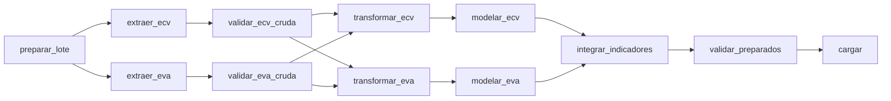

# Orquestación con Airflow

Diseño del DAG `inseguridad_alimentaria_etl` ([`dags/etl_dag.py`](../dags/etl_dag.py)): estructura, contrato de cada tarea, política de fallas y reintentos, observabilidad y cómo ejecutar los tests A, B y C.

Principio: Airflow orquesta; no transporta datos. Entre tareas solo viaja la **ruta del lote**. Los datos viven en archivos dentro del lote.

## 1. Estructura



| Estructura conceptual del enunciado | Tareas del DAG |
|---|---|
| `extract_primary` → `validate_primary_raw` | `extraer_ecv` → `validar_ecv_cruda` (compuerta 1) |
| `extract_api` → `validate_api_raw` | `extraer_eva` → `validar_eva_cruda` (compuerta 2) |
| ambas ramas cumplen la política | Las dos transformaciones dependen de **ambas** compuertas crudas |
| `transform_and_clean_and_integrate` | `transformar_ecv`, `modelar_ecv`, `transformar_eva`, `modelar_eva`, `integrar_indicadores` |
| `validate_prepared` | `validar_preparados` (compuerta 3) |
| `load_dimensional_dw` | `cargar` |

Configuración: `schedule=None` (ejecución manual), `catchup=False`, `max_active_runs=1`, `retries=0` por defecto y `execution_timeout` de 30 min por tarea. Parámetro `falla_controlada` (falso por defecto) para el test B.

## 2. El lote

Cada corrida trabaja sobre `data/batches/<id>/`, con `id = sha256(run_id)[:24]`. Un reintento de la misma corrida reutiliza el mismo lote y las mismas copias congeladas.

```
data/batches/<id>/
├── lote.json                      run_id y fecha de creación
├── ecv/raw/*.csv                  ECV congelada (sha256 en ecv/manifiesto.json)
├── ecv/procesado/*.parquet        tabla transformada, 5 dimensiones y hecho de hogares
├── eva/raw/eva_2024_2025.json     respuesta de la API con fecha, conteos y páginas
├── eva/procesado/*.parquet        agregado, dim_departamento, dim_cultivo y 2 hechos
├── integrado/procesado/*.parquet  fact_indicadores_departamento
├── calidad/compuerta_{1,2,3}.json reporte de cada compuerta
└── carga/carga.json               filas cargadas por tabla
```

Todo archivo queda registrado con su sha256 en el manifiesto de su fuente y se verifica antes de leerlo. Un archivo alterado detiene el pipeline.

## 3. Contrato de cada tarea

| Tarea | Entrada | Salida (en el lote) | Falla si… | Al re-ejecutar |
|---|---|---|---|---|
| `preparar_lote` | `run_id` de Airflow | `lote.json`; devuelve la ruta | — | Reutiliza el lote |
| `extraer_ecv` | Ruta del lote; CSV en `data/raw/ecv/` | 3 CSV congelados con sha256 | Falta un CSV | Reutiliza las copias congeladas |
| `validar_ecv_cruda` | Ruta del lote | `calidad/compuerta_1.json` | Regla crítica C1 o C2 | Vuelve a validar los mismos archivos |
| `extraer_eva` | Ruta del lote; `falla_controlada` | `eva/raw/eva_2024_2025.json` | API caída tras reintentos (transitorio); HTTP 4xx o respuesta inválida (determinista) | Reutiliza la extracción; no llama a la API |
| `validar_eva_cruda` | Ruta del lote | `calidad/compuerta_2.json` | Regla crítica C3 a C9 | Vuelve a validar la misma extracción |
| `transformar_ecv` | Ruta del lote | `ecv/procesado/hogares_transformados.parquet` | Archivo alterado | Reescribe el mismo resultado |
| `modelar_ecv` | Ruta del lote | 5 dimensiones y `fact_seguridad_alimentaria_hogar` | Archivo alterado | Reescribe el mismo resultado |
| `transformar_eva` | Ruta del lote; `config/canasta_cultivos.csv` | `eva/procesado/produccion_agregada.parquet` | Cultivo sin clasificar en la canasta | Reescribe el mismo resultado |
| `modelar_eva` | Ruta del lote; DIVIPOLA | `dim_departamento`, `dim_cultivo`, `fact_produccion_agricola`, `fact_variacion_produccion` | Departamento o cultivo sin dimensión | Reescribe el mismo resultado |
| `integrar_indicadores` | Ruta del lote | `fact_indicadores_departamento` | Departamento de la ECV sin dimensión | Reescribe el mismo resultado |
| `validar_preparados` | Ruta del lote | `calidad/compuerta_3.json` | Regla crítica C10 a C16 | Vuelve a validar |
| `cargar` | Ruta del lote; `sql/create_tables.sql` | 11 tablas en el warehouse; `carga/carga.json` | Compuerta 3 no aprobada; base inaccesible (transitorio); error de base o conciliación (determinista) | `TRUNCATE` + `INSERT`: mismos datos, sin duplicados |

Señal de falla: cada etapa lanza `ErrorTransitorio` o `ErrorDeterminista` (`src/comun/errores.py`). El DAG convierte el determinista en `AirflowFailException`. La tarea queda en `failed` y las dependientes en `upstream_failed`.

## 4. Fallas y reintentos

| Condición | Tipo | Respuesta | Reintento | Justificación |
|---|---|---|---|---|
| API sin respuesta, timeout, HTTP 429 o 5xx | Transitoria | El extractor reintenta la petición 3 veces (espera 2, 4 y 8 s). Si persiste, la tarea falla | `extraer_eva`: 2 reintentos cada 5 min | La misma petición puede funcionar más tarde. Los 5 min cubren caídas más largas que los ~14 s internos |
| Warehouse inaccesible | Transitoria | La carga falla antes de tocar datos | `cargar`: 2 reintentos cada 1 min | El contenedor puede estar reiniciando. La carga es una transacción, repetirla es seguro |
| Regla crítica de Great Expectations | Determinista | La compuerta falla; no se transforma ni se carga; queda el reporte | No | Repetir reproduce la misma falla. Hay que corregir la causa |
| Esquema de la API distinto, conteo que no concilia | Determinista | Falla la compuerta 2 (C3, C4) | No | Contrato de la fuente roto |
| Archivo del lote alterado (sha256) | Determinista | Falla la tarea que lo lee | No | La evidencia del lote ya no es confiable |
| CSV de la ECV faltante | Determinista | Falla `extraer_ecv` con instrucción de descarga | No | Requiere acción manual |
| Solo advertencias (A1, A2, A3) | Advertencia | El pipeline continúa; quedan en el reporte y en el log | — | No invalidan los resultados |

No hay un `retries` global: cada reintento está en la tarea que lo necesita.

## 5. Observabilidad

El log de cada tarea responde:

| Pregunta | Dónde |
|---|---|
| ¿Qué lote? | `preparar_lote`: id del lote y `run_id` |
| ¿Qué se extrajo? | `extraer_ecv`: archivos y sha256. `extraer_eva`: registros y páginas por año frente al `count(*)` de la API, y fecha de extracción |
| ¿Cuántos registros? | Cada tabla producida: filas × columnas. `cargar`: filas por tabla conciliadas |
| ¿Pasó la validación? | Cada compuerta: estado, número de expectativas, métricas, advertencias, reglas críticas fallidas con ejemplos y ruta del reporte |
| ¿Dónde falló y qué pasó después? | Tarea en `failed` con el mensaje del error; dependientes en `upstream_failed`; reintentos visibles en el historial de la tarea |

## 6. Ejecución y tests

Preparación: `.env` creado desde `.env.example`, los CSV de la ECV en `data/raw/ecv/` y luego:

```bash
docker compose up -d --build
```

Interfaz en `http://localhost:8081`. El DAG aparece pausado: actívalo antes de ejecutarlo.

| Test | Cómo | Qué debe verse |
|---|---|---|
| **A. Corrida exitosa** | Trigger con `falla_controlada = false` | Las 12 tareas en `success`. Compuerta 3 aprobada con advertencia A3 (Guaviare). 92.496 filas cargadas |
| **B. Falla crítica controlada** | Trigger con `falla_controlada = true` | `extraer_eva` en `success` con la advertencia de falla controlada en el log. `validar_eva_cruda` en `failed` por C7. Transformaciones, integración, compuerta 3 y carga en `upstream_failed`. El warehouse no cambia |
| **C. Re-ejecución segura** | Sobre la corrida del test A: *Clear* de la corrida completa (mismo `run_id` → mismo lote) o una corrida nueva | Mismos conteos y huellas en las 11 tablas antes y después |

Consulta para comparar el warehouse antes y después del test C:

```sql
SELECT 'fact_seguridad_alimentaria_hogar' AS tabla, count(*) AS filas,
       md5(string_agg(t::text, '|' ORDER BY t::text)) AS huella
FROM fact_seguridad_alimentaria_hogar t
-- repetir para cada una de las 11 tablas
;
```

Ante una falla a mitad de la carga, PostgreSQL revierte la transacción completa y el warehouse queda con la carga anterior. Las tareas previas a la carga solo escriben dentro del lote.
